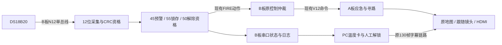

> 历史父版说明：本包已增加独立HDMI温度OSD，须配套更新本包A/B；当前功能、时序、验证和烧录方法以README.md、HDMI温度叠加验证报告_20261030.md及tools/verify_temperature_osd.py为准。下文为父版历史记录。

# 板载10kΩ模块适配复核（2026-10-30）

本版从ds18b20_console_20261029另存，356项FPGA生产输入、PC程序及配套A/B四个固件逐字节保持。此次修正文档并新增10kΩ延迟上拉模型测试；没有重新综合或布局布线，原时序、资源和DRC按精确输入/固件不变沿用。已烧录父版配套A/B时无需重刷；早于父版的固件仍须配套升级。最新核验入口：tools/verify_modulefit.py；原49份选用报告与本次RC报告分开记录。

# DS18B20整板与控制台接入验证报告


直接从本轮已授权的slow_carousel_20261029另存，承接普通轮播3/5/8秒与T03S/T05S/T08S。当前唯一最佳仍emergency_console_20261027；原工程、固件、压缩包及独立DS18B20模块保留，不自动晋升，不合入fast_start/resource_margin/map_flow或已停止音频试验。当前核验入口tools/verify_modulefit.py（同时只读调用父版核验器），旧入口和旧scope为历史记录。

## 工程结合路径



## 接线与烧录

用户已确认B板：模块VCC→J2-29（3.3V），GND→J2-30，DQ/DO→J2-37（GPIOB_32、FPGA N12）。本次指定蓝色成品模块的R1标记103，即10kΩ，已接在DQ与VCC之间，无需外加上拉电阻；R2标记102，即1kΩ，为电源指示灯限流。FPGA继续仅拉低或高阻、PULLTYPE=NONE，由模块R1提供上拉。模块应使用3.3V供电，以使DQ高电平也是3.3V。DO/DQ是双向单总线数据线，并非单向报警输出。两侧接口的VCC/GND物理顺序相反，应按各自丝印连接。模块信息依据用户商品图，实物方向、电压和测温尚未实测。

必须配套PROGRAM_FLASH本包firmware/A_display_3V3.bit和B_control_3V3.bit。A也有本地告警所有权保护修改，不能只更新B。含USB供电完全断电约5秒，再两板一起上电；TF在A，HDMI在A，电脑串口接B板载CH340。卡内图片、音乐不变。未执行实体烧录、测温、COM或HDMI验收。

## 实际运行规则

1. B板25MHz逻辑驱动单总线，设置12位模式，转换等待760ms后读满9字节并校验CRC、配置与量程。标称每1秒启动一轮采样；连续3样本不是固定3秒应急响应承诺。支持负温，原始值除以16得到摄氏度；12位步进0.0625℃，界面4位小数不是0.0001℃测量精度。
2. 有效温度≥45℃给出预警；有效温度连续3次≥55℃锁存高温，B独立向现有V12通道请求FIRE，进入原火灾地图/寻路/HUD及跟随流程。电脑未连接时，板端采集、锁存和应急请求仍工作。双板离线时请求等待，恢复后再按资格接受；离线期间合格降温并人工解除可取消尚未接受的请求。
3. 这是单测点高温触发，复用既有火灾事件及默认危险区域，不自动识别探头所在建筑，不生成新的火灾坐标。
4. 锁存期间，B板退出/切事件按键及串口STOP/其他事件请求被保护，封路操作仍可用。探头断开、CRC错或样本过期均不能自动消除已锁存告警；无有效数据时显示温度未知，旧raw只保留诊断价值。温度锁存是易失运行状态，复位/断电后重新采样确认。
5. 连续3个有效样本≤50℃后，才允许TEMP CLEAR或B板S3人工解除温度锁存。S3这一次只解除温度锁存；温度解除不会自动退出地图，之后另行STOP或再次正常S3请求恢复轮播。温度仍≥45℃时预警继续。过热或故障时解除被拒绝。
6. A本地按键保留最高优先级。正在运行且由A本地拥有的告警不被远程FIRE改事件或夺权，后续远程STOP也不能清除它；需要A本地处理。沿用原远程心跳去重，不借本次改动强制覆盖A本地操作。SRC=2表示B当前请求来自温度触发，不保证A实际事件只由探头导致；REQ/ACT/ACK/FRESH/APPLY仍分别判断。

## 电脑控制台与串口

启动本包“启动应急管理控制台.cmd”，选择B板COM并连接，115200 / 8N1。原串口单后台线程复用轮询、事件、路障、日志及130帧字幕事务；不要让其他工具同时占用该COM。新增“探头温度”卡片、“人工解除温度锁存”按钮，以及温度状态审计CSV。自动联动开启时，正常预警发布温度提示，确认的应急状态发布既有路线字幕；故障/断线/路线未确认时不推荐旧出口。字幕仍需要电脑工具连接并完成既有上传/CRC/VS确认链路；板端自动应急不依赖电脑。未给A增加温度数值HUD或新的V12包类型。

手工串口命令使用ASCII大写，每条以LF或CRLF结束；不用HEX发送模式：

```text
PING
STATUS?
TEMP?
TEMP CLEAR
DEMO STOP
```

TEMP?和STATUS?返回原状态字段并扩展：SENSOR=DS18B20、TRAW=0xHHHH、TV、TW、TA、TC、TF。TRAW按16位有符号数解释再除以16，如0x0191=25.0625℃，0xFF5E=-10.1250℃；仅TV=1时可作为当前温度。TV有效、TW预警、TA锁存、TC可人工解除。TF：0无错误，1无探头，2总线异常，3CRC错，4配置/量程错，5转换未完成，6内部状态恢复，7尚无新鲜有效样本。上电初次转换前TV=0正常，不把初值0显示成实测0℃。

TEMP CLEAR回复OK TEMP REQUEST仅表示接受解除请求，需再次TEMP?或STATUS?确认TA=0。过热/无有效冷却资格回复ERR SENSOR_COOL；锁存时STOP/事件命令回复ERR SENSOR_LOCK。确认TA=0后，仍须独立发DEMO STOP请求恢复正常；OK REQUEST不是HDMI完成证明。A本地拥有的告警可能保持ACT=1、ACK=0。

板端保留原64条易失事件快照：新增TYPE=13温度FIRE接受、TYPE=70温度标志变化，DATA为有符号raw，CTX低位编码为TF[6:4]/TV[3]/TW[2]/TA[1]/TC[0]。不逐样本写满板端日志；电脑记录变化读数并可导出CSV。CSV时间为电脑观察时间，MS是板上电毫秒，不是RTC采样时刻。无RTC、TF持久日志或新报警音。断开电脑不发STOP，也不会自动清除最后字幕。

## 验证边界

父版相对slow_carousel整合时的生产范围为356项，11项原输入修改、4项已验证独立传感器RTL原样加入、341项精确不变。原B ADC/SDC完整字节前缀保留，仅追加N12 IO和原始DQ异步入口例外；A原引脚/时钟/约束不改。两级单bit同步、TF/SDRAM/FIFO刷新和白线保护、16建筑/真实持续跟随/三缩放/HUD/封路/音源/字幕/17阶段保持。父版发布时两板已按当时当前源完成真实综合、原生布局布线、保持修复、最终候选约束、四DRC和bitgen签核；本次按源与固件精确不变沿用，没有重新综合/布线。具体继承时序/资源见验证报告。未伪造All阶段标记，早期未通过/已停止的物理搜索及旧源结果不作为最终通过证明。

真实DQ模型覆盖正常/负温/CRC/离线/锁存/人工解除；另有原生V12 MAC/PHY、实际A控制/寻路、115200完整字幕/VS/像素/48kPCM并发回归。归属状态改为仅由A本地键更新的local_owned编码，与先前受保护RTL的131076拍逐拍对比一致，并重跑44项所有权检查及原生链路。后者注入已资格化的温度样本，媒体大存储省略、PHY等待缩短；前者保持760ms转换但用1MHz时钟测试，独立模块25MHz证据精确不变沿用。WinForms为真实离屏渲染与回调、串口为模拟。不能据此宣称实体测温精度、冷启动、HDMI FPS、白线长测、功耗或眼图已验收。

原串口一次使用后断开问题尚未确认修复；原CDC/SDC覆盖、首次加载、单端重启和长等待限制保持。实板需先常温读数/负温或可信参考对照，再验证预警、锁存、拔探头保持、降温人工解除及独立STOP、A本地告警保留，并回归轮播/音频/字幕/持续镜头和白线长测。不生成交接文档。

## 当前原生签核

### A_display

SWNS: 0.189ns, STNS: 0.000ns.
HWNS: 0.023ns, HTNS: 0.000ns.


```text
#slices 9507/9800
#lut                    16857   out of  19600   86.01%
#reg                    11547   out of  19600   58.91%
  #lut only              6467   out of  18014   35.90%
  #reg only              1157   out of  18014    6.42%
  #lut&reg              10390   out of  18014   57.68%
#bram                      61   out of     64   95.31%
  #bram9k                  61
#bram32k                   14   out of     16   87.50%
#dsp                       20   out of     29   68.97%
#pll                        4   out of      4  100.00%
  Index   |  Name          |  Frequency   |  LUT As Logic   |  LUT As Shifter   |  LUT As Dram   |  BRAM   |  DSP
#1        u_ethernet_pll/clk0_buf                             Global             pll                u_ethernet_pll/pll_inst.clkc0    3018/3018
#2        video_pll_m0/clk0_buf                               Global             pll                video_pll_m0/pll_inst.clkc0      2743/2743
#3        U3/u2_ram/u1_init_ref/Sdr_clk                       Global             pll                sys_pll_m0/pll_inst.clkc1        496/496
#5        sys_pll_m0/clk0_buf                                 Global             pll                sys_pll_m0/pll_inst.clkc0        272/272
#7        u_hdmi_audio_tone_i2s_64fs/I_mclk                   Global             pll                u_audio_pll/pll_inst.clkc2       98/98
#8        u_hdmi2phy_wrapper/u0_lane_lvds_8_1/I_serial_clk    Global             pll                video_pll_m0/pll_inst.clkc1      29/29
#9        u_audio_pll/clk0_buf                                Global             pll                u_audio_pll/pll_inst.clkc0       1/1
#10       u_ethernet_link/tx_clk90                            Global             pll                u_ethernet_pll/pll_inst.clkc1    1/1
#11       U3/u2_ram/SDRAM_CLK                                 Global             pll                sys_pll_m0/pll_inst.clkc2        0/1
|Instance                                    |Module                                            |le      |lut     |ripple  |seq     |bram    |dsp     |
```

Current-source TD2026.1SP2 All synthesis/gate verified. Selected same source-bound gate with fresh native seed25 placement/routing/hold repair; temporary stricter search targets cleared and exact candidate SDC reloaded before final positive setup/hold, four DRC and bitgen. Original All physical result is unselected; no fabricated markers or claim that original All completed successfully.

### B_control

SWNS: 0.121ns, STNS: 0.000ns.
HWNS: 0.030ns, HTNS: 0.000ns.


```text
#slices 9409/9800
#lut                    16862   out of  19600   86.03%
#reg                    11078   out of  19600   56.52%
  #lut only              6919   out of  17997   38.45%
  #reg only              1135   out of  17997    6.31%
  #lut&reg               9943   out of  17997   55.25%
#bram                      49   out of     64   76.56%
  #bram9k                  49
#bram32k                   15   out of     16   93.75%
#dsp                        9   out of     29   31.03%
#pll                        2   out of      4   50.00%
  Index   |  Name          |  Frequency   |  LUT As Logic   |  LUT As Shifter   |  LUT As Dram   |  BRAM   |  DSP
#1        u_ethernet_pll/clk0_buf                                  Global             pll                u_ethernet_pll/pll_inst.clkc0                        3849/3849
#2        media_service$u_storage/sys_pll_m0/clk0_buf              Global             pll                media_service$u_storage/sys_pll_m0/pll_inst.clkc0    2205/2205
#3        media_service$u_storage/U3/u2_ram/u1_init_ref/Sdr_clk    Global             pll                media_service$u_storage/sys_pll_m0/pll_inst.clkc1    504/504
#6        u_ethernet_link/tx_clk90                                 Global             pll                u_ethernet_pll/pll_inst.clkc1                        1/1
#7        media_service$u_storage/U3/u2_ram/SDRAM_CLK              Global             pll                media_service$u_storage/sys_pll_m0/pll_inst.clkc2    0/1
|Instance                                         |Module                                            |le      |lut     |ripple  |seq     |bram    |dsp     |
```

Current-source TD2026.1SP2 All synthesis/gate verified. Selected same source-bound gate with fresh native seed36 placement/routing/hold repair; temporary stricter search targets cleared and exact candidate SDC reloaded before final positive setup/hold, four DRC and bitgen. Original All physical result is unselected; no fabricated markers or claim that original All completed successfully.

选用13份本次/重跑报告、36份精确输入不变报告；3份历史报告未选用。独立模块3份报告为原有精确证据沿用，没有冒充本次新跑25MHz或独立综合。当前选用清单和输入逐项哈希由只读核验器检查。
