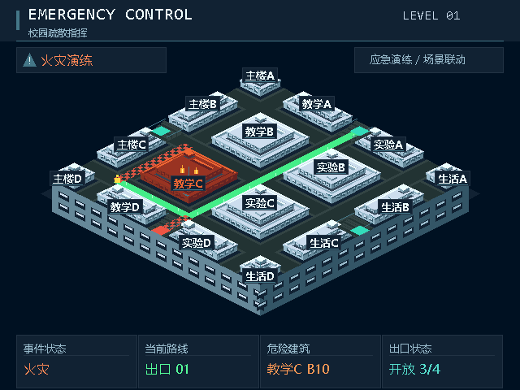
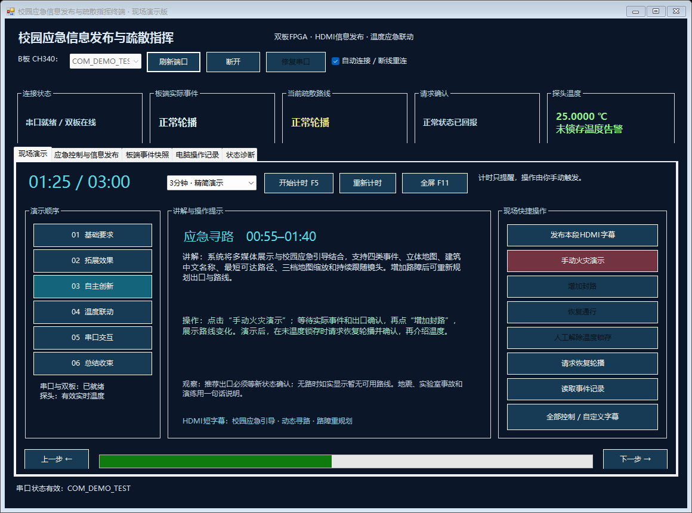
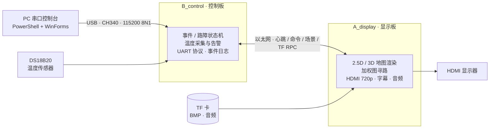

<div align="center">

# 嵌入式FPGA国三 · 安路赛题一

### HX4S20C 双板 FPGA 应急管理显示系统

**一块板负责“看见”，一块板负责“决策”。**

HDMI 多媒体展示 · 2.5D/3D 校园地图 · 板上动态寻路 · DS18B20 温度联动 · 中英文串口字幕 · 双板以太网协作

[](LICENSE)
[](#硬件与接线)
[](#从源码构建)
[](#目录结构)
[](https://www.bilibili.com/video/BV1vJ4g6WEps/)

</div>

<p align="center">
  
  
</p>

<p align="center"><sub>左：A 板 HDMI 输出的 2.5D 校园应急地图（火灾 + 封路 + 推荐出口）　右：PC 串口控制台现场演示页</sub></p>

---

## 项目简介

作为**安路赛题一**的参赛作品，这是一个面向**校园应急疏散**的纯 FPGA 双板系统。它把“多媒体展示”和“应急引导”做在同一条视频链路上：平时是一块能放图、放音乐、做转场和音频可视化的校园信息屏；发生火灾、地震或实验室事故时，同一块屏立即切换为立体校园地图，由板上逻辑完成封路、最短可达路径计算和推荐出口显示，并持续跟随镜头引导。

系统由两块 **安路 HX4S20C** 开发板组成：

- **A 板（A_display）**：TF 卡读取、SDRAM 帧缓存、2.5D/3D 地图渲染、寻路、HDMI 720p 输出、字幕与音频；
- **B 板（B_control）**：按键与串口事件、路障状态机、DS18B20 温度采集与告警、以太网命令/心跳、板端事件日志；
- **PC 控制台**：通过 B 板板载 CH340 串口连接，负责人工事件、路障、温度解锁、中英文字幕发布、状态回读、日志导出和现场演示计时。

> 竞赛成绩：嵌入式 FPGA 国三（国家级三等奖） · 安路赛题一。

## 演示视频

**▶ [FPGA国赛：多媒体展示与温度感知应急引导系统（Bilibili）](https://www.bilibili.com/video/BV1vJ4g6WEps/)**

3 分钟现场实拍：HDMI 多媒体播放、2.5D 校园地图与动态寻路、封路重规划、DS18B20 温度联动、中英文串口字幕和 PC 控制台操作。

## 功能特性

### 1. HDMI 多媒体与视觉

- 从 TF 卡读取 24 位 BMP（FAT32），经 SDRAM 缓存后由 HDMI 稳定输出 **1280×720** 画面；
- 手动切图、**3 / 5 / 8 秒**自动轮播、暂停，以及 **48 kHz** 音频同步输出；
- 翻牌、缩放、棋盘、粒子进出等 **17 阶段转场**，支持实时亮度/对比度调节；
- 音频频谱、波形、包络叠加与音源选择；
- 3D 视角校园地图与 2.5D 地图两套渲染路径，建筑中文名称、HUD、罗盘、图例均为板上绘制。

### 2. 应急地图与动态寻路

- 支持**火灾、地震、实验室事故、演练**四类事件；
- 16 栋建筑（主楼 / 教学 / 实验 / 生活 × A–D）的 2.5D 校园地图，建筑名称、危险边、出口、路线分层合成；
- 板上**加权图最短路径**搜索，四个候选出口（北 / 西 / 东 / 南），封路后重新规划；
- 路障档位 **0–3**：0 仅事件基础封路，3 关闭全部四个出口支路（用于演示 `NO PATH`）；
- 路线跟随镜头、三档缩放、危险建筑闪烁与出口箭头；
- A 板本地按键与 B 板远程请求的**所有权保护**：本地告警优先，远程请求不等于画面已确认。

### 3. DS18B20 温度感知与自动联动

- B 板单总线时序直接驱动 DS18B20，12 位转换、9 字节 CRC、配置与量程校验；
- 温度以 16×16 字模叠加在 HDMI **左上角**，约每秒一次有效读数；
- **45 ℃ 预警**；一次有效采样达到 **55 ℃** 即锁存告警并请求火灾预案；
- 降至 **50 ℃ 及以下且连续 3 次有效采样**后，才允许 `TEMP CLEAR` 或 B 板 S3 人工解除；
- 掉线、CRC 错误、过期数据不会清除已有锁存；板端自动测温和告警不依赖电脑。

### 4. 双板以太网协作

- A/B 两板通过板上以太网 MAC/PHY 互联，传输命令、心跳、场景闭路掩码、路线结果和 TF 扇区数据；
- 原子邮箱 + 帧锁存 + 新鲜度（FRESH/AGE）判定，断链立即失效；
- A 板可通过以太网向 B 板发起 TF 扇区 RPC，由 B 板读卡后回传；
- 板端 64 条环形事件日志支持 `LOG READ` / `LOG CLEAR`，记录请求、实际状态、路线变化与错误。

### 5. 中英文串口字幕

- 电脑通过 B 板 CH340 发送正文，FPGA 生成 16 像素高字模，2 倍放大为 32 像素白色像素字；
- 单行、按 16 对齐、最宽 1024 像素（约 64 个汉字），支持中英混排；
- **130 帧**完整字模事务 + 全图 CRC 校验，在实际 VS 边界原子切换，不显示半条字幕；
- A 板复位/断电后字幕丢失，需要重发；字幕正文不写入 TF，也不进事件日志。

### 6. PC 串口控制台

- Windows PowerShell 5.1 + WinForms/C#，**无需 Python 或额外运行库**；
- CH340 自动发现、设备实例记忆、COM 号变化跟踪、2/4/8/15 秒退避重连；
- 针对设备代码 10 的定向重启修复（仅 `VID_1A86&PID_7523`，不卸载驱动、不重启电脑）；
- 火灾/地震/实验室/演练、路障 0–3、温度解锁、字幕发布、状态诊断、板端日志与电脑操作记录 CSV 导出；
- 内置 **3 分钟 / 4 分钟**现场演示计时与操作提示页。

## 系统架构



**设计要点**：视频、地图、寻路、字幕、温度告警全部在 FPGA 内完成；电脑只做“人工操作、通知生成、状态记录”，即使拔掉 USB，板端应急与温度告警仍独立运行。

## 硬件与接线

| 项目 | 连接 |
|---|---|
| A 板 | TF 卡、HDMI 显示器、以太网、JTAG/烧录口 |
| B 板 | 板载 CH340 USB 串口、以太网、DS18B20、按键 |
| 双板 | 网线直连，两板分别供电 |
| DS18B20 | VCC → B 板 `J2-29`（3.3 V）；GND → `J2-30`；DQ → `J2-37`（FPGA `N12`） |
| 串口 | B 板 CH340，`115200`、8 数据位、无校验、1 停止位、无流控 |

DS18B20 使用带 10 kΩ 上拉的成品模块即可，无需另接电阻；两侧排针顺序相反，以板上丝印为准。

> 烧录或改接线后，请拔掉包括 USB 在内的全部供电约 5 秒，再让两板一起上电，避免单端重启导致的链路异常。

## 快速开始

### 1. 烧录固件

用安路 TD 2026.1 SP2 的下载工具：

- A 板：`FPGA_project/firmware/A_display_3V3.bit`（或 `.bin` 烧 Flash）；
- B 板：`FPGA_project/firmware/B_control_3V3.bit`（或 `.bin` 烧 Flash）。

`firmware/firmware-map.json` 记录了四个文件的对应关系与 SHA256。只烧 B 板还是 A/B 都烧，取决于两板当前固件是否匹配；不确定时按配套 A/B 一起烧。

### 2. 准备 TF 卡

将 `FPGA_project/assets/tf_card/PREV_BMP/` 整个目录放到 TF 卡**根目录**，保持文件名不变（`01.BMP` … `06.BMP`，含 `02INFO.BMP`、`03INFO.BMP`、`04INFO.BMP`）。卡格式化为 FAT32，插在 A 板。

### 3. 上电与连接

1. A 板接 HDMI 显示器，插好 TF 卡；
2. 两板网线互连，分别供电；
3. B 板 USB 数据线接电脑（不是只接 JTAG 下载口）；
4. 等待 A 板读卡和两板联机完成。

### 4. 启动控制台

双击仓库根目录的 **`01_启动最佳串口控制台.cmd`**。它会请求管理员权限以支持 CH340 设备修复；取消提权仍可正常连接。

在控制台中选择 B 板 CH340 对应的 COM 口，点击“连接”，先确认 `PING` 与完整 `STATUS`，再看顶部是否显示“串口就绪 / 双板在线”。

> 只能同时开一个控制台窗口；启动前请关闭其他串口助手，避免抢占同一 COM 口。

### 5. 建议演示顺序

`正常轮播` → `手动火灾演示` → 等待实际事件/出口确认 → `增加封路` 0–3（含 `NO PATH`）→ 温度读数与阈值说明 → `发布本段 HDMI 字幕` → 读取事件日志 / 导出 CSV → `请求恢复轮播`。

完整的 3/4 分钟讲解词与操作顺序见 [`PC_console/3至4分钟演示词与操作顺序.md`](PC_console/3至4分钟演示词与操作顺序.md)。

## 从源码构建

### 环境

- Windows 10/11；
- **安路 TD 2026.1 SP2**（Tang Dynasty），提供 `td_commands_prompt.exe`；
- Windows PowerShell 5.1；
- Python 3（资源生成与部分校验脚本，按需安装 `numpy`、`Pillow`）；
- ModelSim / QuestaSim（RTL 仿真，`tests/modelsim.ini` 已给出库映射）。

### 综合、布局布线与 bit 生成

```powershell
$env:TD_CLI = 'C:\path\to\TD\bin\td_commands_prompt.exe'

powershell -ExecutionPolicy Bypass -File .\FPGA_project\A_display\project\build_verified.ps1 -Stage All
powershell -ExecutionPolicy Bypass -File .\FPGA_project\B_control\project\build_verified.ps1 -Stage All
```

`build_verified.ps1` 不是简单的“跑一遍工具”：它会记录源文件 SHA256，要求综合、布局、布线、bitgen 各阶段都有本次运行的新鲜结束标记，并检查建立/保持时间、四类 DRC、bit 头中的 TD 版本；任一不满足就拒绝发布 bit/bin。产物写入 `FPGA_project/output/`。

### 仿真与校验

`FPGA_project/tests/` 保留了 200+ 个 Verilog/SystemVerilog 测试平台和 Python 校验脚本，覆盖地图、寻路、以太网、TF 卡、字幕、温度、转场、资源/时序等模块。典型入口：

```powershell
python .\FPGA_project\tests\run_emergency_console.py
python .\FPGA_project\tools\verify_temperature_single.py
```

> 为控制仓库体积，`tests/` 下大于 512 KB 的 golden 向量/抓取数据未入库，清单见 [`FPGA_project/tests/EXCLUDED_VECTORS.md`](FPGA_project/tests/EXCLUDED_VECTORS.md)。依赖这些向量的测试需要从作者本地完整快照或实际硬件重新采集。

## 目录结构

```text
.
├─ FPGA_project/
│  ├─ A_display/          # 显示板：RTL、约束、TD 工程脚本、厂商 IP、时序/构建证据
│  ├─ B_control/          # 控制板：RTL、约束、TD 工程脚本、厂商 IP、时序/构建证据
│  ├─ common/             # 两板共享的以太网/地图/音频/转场 RTL
│  ├─ firmware/           # 预编译 A/B bit 与 bin
│  ├─ assets/             # TF 卡 BMP、地图/字体/UI/音频资源、预览图与 GIF
│  ├─ tests/              # ModelSim 测试平台、Python 校验脚本、小体积向量
│  ├─ tools/              # 资源生成、温度/字幕/链路验证脚本
│  └─ *.md                # 各阶段设计、验证与复盘报告
├─ PC_console/            # PowerShell + C# 串口控制台、测试与现场演示词
├─ docs/images/           # README 截图
└─ 01_启动最佳串口控制台.cmd
```

## 文档索引

| 文档 | 内容 |
|---|---|
| [`FPGA_project/README.md`](FPGA_project/README.md) | 当前发布版本的策略、修改范围、资源与时序结果 |
| [`应急管理控制台使用说明`](FPGA_project/应急管理控制台使用说明_20261027.md) | 控制台操作、状态字段含义、日志与断链处理 |
| [`中英文串口字幕使用说明`](FPGA_project/中英文串口字幕使用说明_20261026.md) | 字幕协议、限额、CRC 与常见问题 |
| [`场景ABC映射说明`](FPGA_project/场景ABC映射说明_20261025.md) | 事件 / 出口 / 路障的参数映射 |
| [`两板资源与时序优化报告`](FPGA_project/两板资源与时序优化报告_20261025.md) | 双板资源、时序、优化过程 |
| [`640x480立体应急地图替换与验证报告`](FPGA_project/640x480立体应急地图替换与验证报告_20261025.md) | 地图渲染与验证 |
| [`DS18B20整板接入验证报告`](FPGA_project/DS18B20整板接入验证报告_20261029.md) | 温度链路、时序与故障注入 |
| [`HDMI温度叠加验证报告`](FPGA_project/HDMI温度叠加验证报告_20261030.md) | 温度 OSD 与视频链路 |
| [`单次高温采样报警验证报告`](FPGA_project/单次高温采样报警验证报告_20261031.md) | 55 ℃ 单次有效采样锁存策略 |
| [`粒子进出转场验证报告`](FPGA_project/粒子进出转场验证报告_20261031.md) | 粒子转场与并发验证 |
| [`PC_console/使用说明.md`](PC_console/使用说明.md) | 串口自恢复、CH340 修复与验证边界 |
| [`PC_console/3至4分钟演示词与操作顺序.md`](PC_console/3至4分钟演示词与操作顺序.md) | 现场讲解词与操作节奏 |

## 已验证内容与边界

**已完成的验证（详见各报告）：**

- TD 2026.1 SP2 下 A/B 两板真实综合、布局布线、bitgen，建立/保持时间为正，四类 DRC 通过；
- 当前选用结果：A 板 9584/9800 Slice、LUT 16962、寄存器 11614；B 板 9585/9800 Slice、LUT 17332、寄存器 11104；
- 温度策略在 1 MHz 与生产 25 MHz 下各 27 项检查通过（首次上电、过期/离线恢复、负温与阈值边界、坏 CRC、重复事件、冷却三样本、人工解除保护等）；
- 字幕 130 帧事务、48 kHz PCM 与视频并发重跑；双板以太网命令/场景/路线链路注入验证；
- PC 控制台通过核心回归、GUI 回归、温度解析与恢复策略测试，并在本机真实 CH340 上完成自动发现、连接、断开与定向重启。

**需要明确的边界：**

- 本仓库是“最佳发布快照”的整理版，**没有为本次开源重新烧录或重新做实体 HDMI/COM/温度精度验收**；
- 温度阈值、探头热响应、实际升温/降温时间需按现场条件实测，报告中的仿真/注入结论不等同于实板计量校准；
- 未做 HDMI 眼图、功耗、长时间白线/冷启动寿命测试；
- PC 控制台的部分 GUI 测试为离屏渲染与程序化委托触发，串口故障注入为模拟，不等于完整人工鼠标/实体链路验收；
- `tests/` 的大体积 golden 向量未入库，部分测试需要完整快照或硬件才能复现。

## 第三方组件与素材

- `FPGA_project/A_display/vendor/` 与 `B_control/vendor/` 来自 HX4S20C 开发板厂商资料包，包含加密的 HDMI 1.4b Transmitter Core、SDR 控制器、PLL/ROM 等 IP。其版权归原厂商/原作者所有，**不在本仓库 MIT 许可范围内**，此处仅为工程可复现而保留。公开复用或商业使用前请自行核对厂商授权；如权利人提出异议，将移除对应文件。
- `FPGA_project/assets/tf_card/PREV_BMP/`、预览 GIF/PNG 与音频素材为项目演示素材；若其中包含第三方图片、字体或音乐，请替换为你有权使用的素材。
- `chinese_title_rom.v`、字幕字模等由项目脚本生成；若字模来源于系统字体，商用前请确认字体授权。

完整说明见 [`THIRD_PARTY_NOTICES.md`](THIRD_PARTY_NOTICES.md)。

## 许可证

本仓库中由项目作者原创的 RTL、软件、脚本与文档采用 **MIT License**，详见 [`LICENSE`](LICENSE)。

你可以自由使用、修改、分发和商用，但需保留版权声明；软件按“原样”提供，不附带任何担保。第三方组件与素材除外。

---

<p align="center"><sub>如果这个项目对你有帮助，欢迎 Star ⭐ / Fork 🍴 / 提 Issue。</sub></p>
